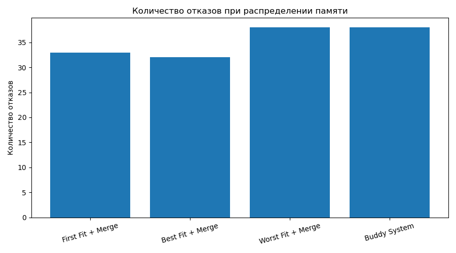
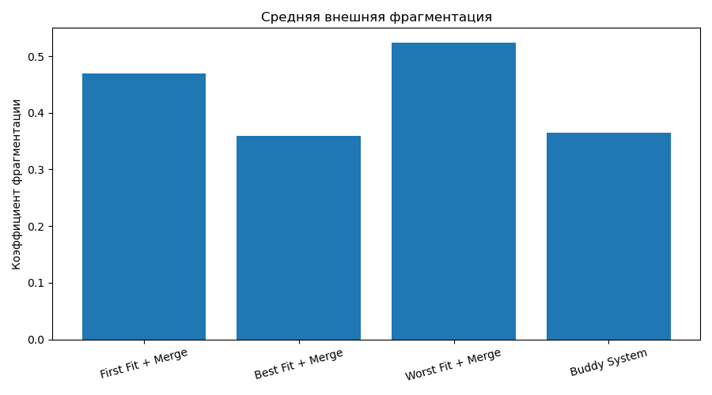
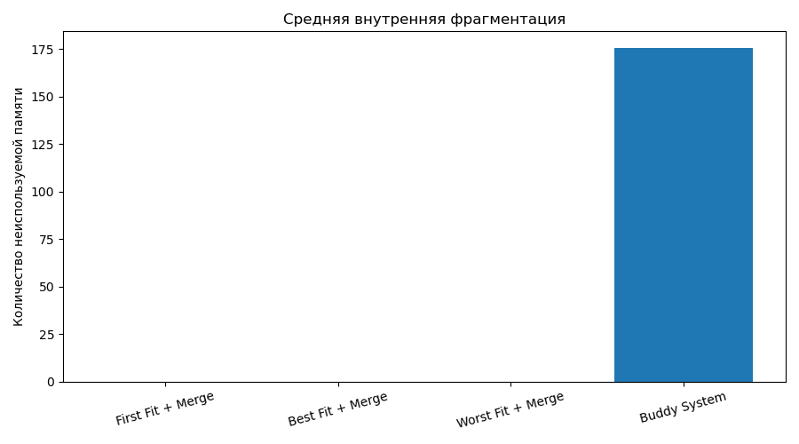

# Практическая работа №9 — Распределение памяти

## Цель работы

Изучить алгоритмы распределения динамической памяти, сравнить First Fit, Best Fit и Worst Fit, исследовать внешнюю и внутреннюю фрагментацию, а также реализовать слияние свободных блоков и Buddy System.

Начальный размер памяти — **1024 единицы**.

# Вариант A — Алгоритмы распределения памяти

## 1. Реализованные стратегии

- **First Fit** — выбирает первый свободный блок, подходящий по размеру.
- **Best Fit** — выбирает наименьший подходящий свободный блок.
- **Worst Fit** — выбирает самый большой свободный блок.

## 2. Результаты на ops1.txt

| Стратегия | Свободная память | Наибольший блок | Свободных блоков | Отказов |
|---|---:|---:|---:|---:|
| First Fit | 904 | 250 | 5 | 3 |
| Best Fit | 624 | 250 | 5 | 2 |
| Worst Fit | 904 | 250 | 5 | 3 |

First Fit и Worst Fit получили отказы на операциях 8, 10 и 12. Best Fit — на операциях 10 и 12.

## 3. Внешняя фрагментация

Для оценки внешней фрагментации используется формула:

\[
F_{ext}=1-\frac{\text{наибольший свободный блок}}{\text{общая свободная память}}
\]

| Стратегия | Внешняя фрагментация |
|---|---:|
| First Fit | 0.72 |
| Best Fit | 0.60 |
| Worst Fit | 0.72 |

## 4. Анализ операции 8

При использовании First Fit на операции 8 процесс P6 запрашивает 280 единиц памяти.

В этот момент суммарно свободно 554 единицы, однако наибольший непрерывный свободный блок составляет только 250 единиц.

Поэтому запрос отклоняется.

Это называется **внешней фрагментацией**: свободной памяти достаточно в сумме, но она разделена на отдельные блоки, и ни один из них не подходит для запроса.

## 5. Вывод по варианту A

На наборе ops1.txt Best Fit показал меньше отказов, чем First Fit и Worst Fit. Однако результаты зависят от последовательности запросов и освобождения памяти.

# Вариант B — Слияние блоков и Buddy System

## 1. Слияние свободных блоков (Coalescing)

Coalescing — это объединение соседних свободных блоков памяти в один большой блок.

Например:

```text
До слияния:
[-:100] [-:150] [-:200]

После слияния:
[-:450]
```

Слияние уменьшает внешнюю фрагментацию и помогает избежать отказов при последующих запросах памяти.

## 2. Сравнение алгоритмов со слиянием и без него

| Стратегия | Отказы без слияния | Отказы со слиянием | Фрагментация без слияния | Фрагментация со слиянием |
|---|---:|---:|---:|---:|
| First Fit | 50 | 33 | 0.78 | 0.47 |
| Best Fit | 45 | 32 | 0.73 | 0.36 |
| Worst Fit | 61 | 38 | 0.87 | 0.52 |

Результаты показывают, что слияние соседних свободных блоков уменьшает количество отказов и внешнюю фрагментацию.

## 3. Buddy System

Buddy System — алгоритм распределения памяти, который использует блоки размером в степени двойки.

При запросе памяти размер блока округляется вверх до ближайшей степени двойки.

Например:

- Запрос 100 единиц — выделяется блок 128.
- Запрос 200 единиц — выделяется блок 256.
- Запрос 300 единиц — выделяется блок 512.

Если подходящий блок слишком большой, он делится на две равные части. При освобождении памяти соседние свободные блоки-близнецы (buddies) могут объединяться обратно.

Результат демонстрации Buddy System:

- Отказов: 38.
- Свободная память в конце: 312.
- Внутренняя фрагментация в конце: 172.

## 4. Сравнение четырёх подходов на ops2.txt

| Подход | Отказы | Средняя внешняя фрагментация | Средняя внутренняя фрагментация |
|---|---:|---:|---:|
| First Fit + Merge | 33 | 0.47 | 0 |
| Best Fit + Merge | 32 | 0.36 | 0 |
| Worst Fit + Merge | 38 | 0.52 | 0 |
| Buddy System | 38 | 0.36 | 175 |

В таблице указана средняя внутренняя фрагментация Buddy System за все операции. Значение 172 из предыдущего раздела — фрагментация в конечном состоянии, поэтому показатели отличаются.

## 5. Графики результатов

### Количество отказов



### Средняя внешняя фрагментация



### Средняя внутренняя фрагментация



## 6. Ответы на контрольные вопросы

**1. Почему Worst Fit может быть полезен?**

Worst Fit выбирает самый большой свободный блок. После выделения памяти он старается оставить достаточно крупный остаточный блок, который может пригодиться для будущих запросов. Однако это не гарантирует лучший результат. В нашем тесте Worst Fit показал 38 отказов, что больше, чем у First Fit и Best Fit со слиянием.

**2. Чем Buddy System платит за уменьшение внешней фрагментации?**

Buddy System платит внутренней фрагментацией. Размер запрошенной памяти округляется вверх до ближайшей степени двойки. Неиспользованная часть выделенного блока остаётся занятой и не может быть использована другими процессами.

## 7. Общий вывод

В ходе практической работы были изучены и сравнены алгоритмы First Fit, Best Fit и Worst Fit.

В варианте A было обнаружено явление внешней фрагментации: свободной памяти может быть достаточно в сумме, но её отдельные блоки не позволяют выполнить запрос.

В варианте B было исследовано слияние соседних свободных блоков. Эксперименты показали, что coalescing уменьшает количество отказов и внешнюю фрагментацию.

Также была реализована Buddy System. Она позволяет объединять блоки и уменьшать внешнюю фрагментацию, но приводит к внутренней фрагментации из-за округления размеров до степеней двойки.

На использованном наборе операций Best Fit со слиянием показал наименьшее количество отказов — 32.
