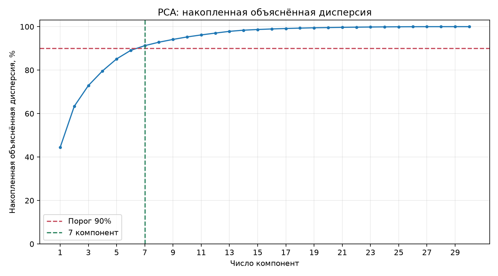
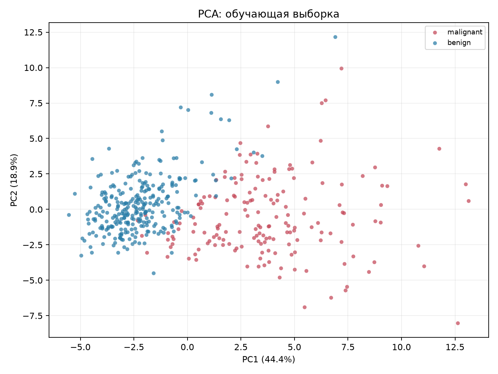
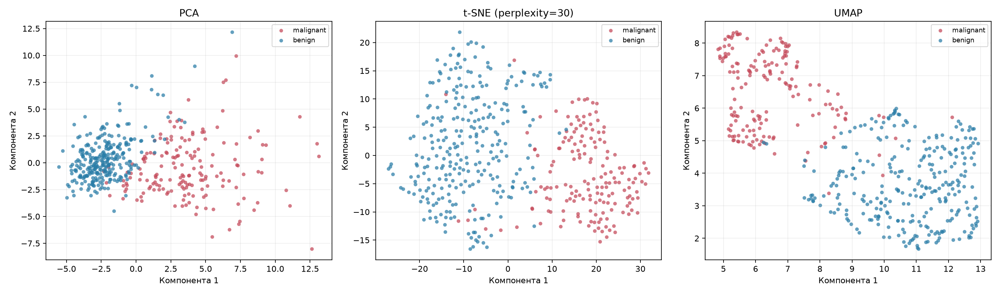
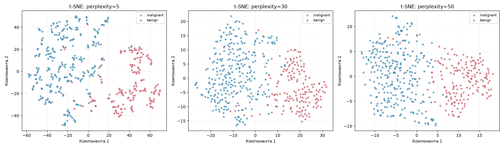

# Практическая работа № 11 — понижение размерности методом главных компонент

Работа охватывает уровни A, B и C. Использован встроенный датасет **Breast Cancer Wisconsin** из `scikit-learn`: 569 объектов, 30 числовых признаков, два класса. Скачивать данные не требуется. Код не обращается к практическим № 1–10 и не меняет их.

## Что лежит в папке

```text
pr11/
├── pr11.py                    # все три уровня и построение графиков
├── requirements.txt           # зависимости Python
├── results.json               # числа из проверенного запуска
├── .gitignore
└── plots/
    ├── 01_cumulative_variance.png
    ├── 02_pca_2d.png
    ├── 03_methods_comparison.png
    └── 04_tsne_perplexity.png
```

Все четыре PNG созданы выполнением `pr11.py`, а не взяты из примера.

## Как запустить самостоятельно

### В VS Code с WSL Ubuntu

1. Распакуйте ZIP. Откройте VS Code и выберите **File → Open Folder**, затем папку `pr11`.
2. Откройте **Terminal → New Terminal**. Если вы работаете в WSL, в левом нижнем углу VS Code должно быть написано `WSL: Ubuntu`.
3. В терминале, находясь в `pr11`, выполните команды:

```bash
python3 -m venv .venv
source .venv/bin/activate
python -m pip install -r requirements.txt
python pr11.py
```

При повторном запуске достаточно `source .venv/bin/activate` и `python pr11.py`. Первый запуск UMAP может занять больше времени из-за подготовки вычислений.

### В Windows PowerShell

```powershell
python -m venv .venv
.\.venv\Scripts\Activate.ps1
python -m pip install -r requirements.txt
python pr11.py
```

Если политика PowerShell запрещает запуск `Activate.ps1`, можно обойтись без активации окружения: `.\.venv\Scripts\python.exe -m pip install -r requirements.txt`, затем `.\.venv\Scripts\python.exe pr11.py`. На WSL при ошибке `ensurepip is not available` установите пакет `python3-venv` и повторите создание окружения.

После запуска ожидается строка `Готово: 4 графика в plots/ и результаты в results.json`. В `plots/` должны быть четыре изображения. При `ModuleNotFoundError` проверьте, что установка зависимостей и запуск выполнены одним и тем же Python из `.venv`. Если UMAP работает медленно, дождитесь окончания первого запуска. Сообщение `t-SNE transform существует: False` ожидаемо: скрипт специально проверяет это свойство. При версии UMAP 0.6.0 может появиться `FutureWarning` о `compatibility_layout`: это уведомление о будущем изменении значения по умолчанию, а не ошибка.

## Методика

Данные разделены на обучающую и тестовую выборки в отношении 80/20 с сохранением долей классов (`random_state=42`). Масштабирование обучается **только на обучающей выборке**. Тестовая выборка служит для финальной проверки классификатора и преобразования новых объектов.

В уровне A `StandardScaler` приводит признаки к сопоставимому масштабу, после чего PCA обучается без ограничения числа компонент. `explained_variance_ratio_` показывает долю дисперсии каждой компоненты. По накопленной сумме определяется первое число компонент, достигающее 90%. Компонента представляет собой линейную комбинацию исходных признаков.

В уровне B сравниваются четыре пайплайна с логистической регрессией: без PCA и с сохранением 80%, 90% или 95% дисперсии. Пятикратная стратифицированная кросс-валидация проводится **только на train**. `StandardScaler` и PCA находятся внутри `Pipeline`, поэтому на каждом разбиении обучаются без сведений о проверочной части. Время `fit_time` включает масштабирование, PCA (если он есть) и обучение модели. Число компонент указано для модели, заново обученной на всей train-выборке; в отдельных CV-разбиениях оно может немного отличаться. Лучший вариант PCA выбирается по среднему CV accuracy, затем он и базовая модель один раз оцениваются на отложенном тесте.

В уровне C PCA, t-SNE и UMAP получают **те же масштабированные train-объекты**. Для t-SNE сравниваются `perplexity=5`, `30`, `50` при одинаковом `random_state=42`. Различие проекций дополнительно оценивается средней долей общих 15 ближайших соседей каждой точки в двух плоскостях. Этот показатель сравнивает локальную структуру и не зависит от поворота или отражения рисунка; он не является метрикой качества классификации.

## Проверенные результаты

На проверенном запуске (точные значения также сохранены в `results.json`):

| Показатель | Результат |
|---|---:|
| Обучающих / тестовых объектов | 455 / 114 |
| Число исходных признаков | 30 |
| Компонент для не менее 90% дисперсии | 7 |
| Фактически сохранённая дисперсия | 91,26% |
| Дисперсия первых двух компонент | 63,36% |

### Уровень A — графики



На первом графике показано, где накопленная дисперсия впервые пересекает порог 90%.



Вторая диаграмма показывает два класса на плоскости PC1/PC2. Поскольку первые две компоненты сохраняют 63,36% дисперсии, двумерное представление полезно для первого обзора, но теряет остальную информацию и не доказывает качество классификации.

### Уровень B — качество, время и размерность

| Вариант | CV accuracy, среднее | CV fit, среднее, с | Признаков у модели | Test accuracy* |
|---|---:|---:|---:|---:|
| Без PCA | 0,9780 | 0,0081 | 30 | 0,9825 |
| PCA 80% | 0,9692 | 0,0075 | 5 | — |
| PCA 90% | 0,9714 | 0,0078 | 7 | — |
| PCA 95% | 0,9824 | 0,0091 | 10 | 0,9737 |

\* Тестовая метрика вычислена только для базовой модели и варианта `PCA 95%`, выбранного по CV. Для остальных вариантов тест не использовался при подборе.

**Вывод о PCA:** PCA 95% сократил число признаков с 30 до 10. Среднее CV accuracy выросло с 0,9780 до 0,9824 (на 0,44 процентного пункта), но различие мало относительно разброса между разбиениями. На отложенном тесте accuracy снизилась с 0,9825 до 0,9737; среднее время обучения полного пайплайна не уменьшилось (0,0081 с против 0,0091 с). Для этой небольшой задачи PCA оправдан как способ сжатия признаков и визуализации, но измеренного выигрыша в качестве или скорости прогноза нет.

Время обучения на таком маленьком наборе измеряется миллисекундами и колеблется от запуска к запуску; отдельные небольшие различия не следует считать доказательством ускорения. Объяснённая дисперсия описывает сохранение вариации признаков, а не сохранение полезной для классификации информации.

### Уровень C — сравнение методов



PCA показывает линейную проекцию максимальной дисперсии. t-SNE и UMAP строят нелинейные двумерные представления, в которых удобнее рассматривать соседства и группы. Положение, масштаб и расстояние между отдельными группами на t-SNE нельзя напрямую читать как расстояния в исходном 30-мерном пространстве. В UMAP тоже нужно осторожно интерпретировать глобальные расстояния. По рисункам видно, что два класса в целом разделяются всеми методами, но в PCA-проекции их области заметнее перекрываются; на t-SNE и UMAP разделение визуально выражено сильнее. В каждой проекции остаются отдельные точки другого класса внутри области группы.



При `perplexity=5` группы выглядят более раздробленными; при 30 и 50 картина становится более цельной. Доля общих 15 соседей в плоскостях t-SNE: `5 ↔ 30` — 55,6%, `30 ↔ 50` — 70,3%. Значит, изменение `perplexity` заметно меняет локальные связи и вид проекции: вывод о структуре следует проверять при нескольких настройках. При этом поворот или отражение картинки сами по себе не означают изменения структуры.

У обученного PCA и UMAP вызов `transform` для пяти новых тестовых объектов дал форму `(5, 2)`. У `sklearn.manifold.TSNE` метода `transform` нет. Причина: стандартный t-SNE оптимизирует координаты сразу для конкретного набора точек и не обучает явное отображение для новых объектов. Поэтому **PCA подходит как шаг обычного прогнозного пайплайна**, а t-SNE в этой реализации используется для визуализации. UMAP поддерживает `transform` и технически может войти в пайплайн, но его применение для прогноза требует отдельной проверки на кросс-валидации. Для этой задачи фактический выигрыш PCA — снижение размерности; выигрыш качества и скорости не подтверждён.

## Как проверялась работа

Скрипт был запущен из папки `pr11`; проверены выход без исключений, содержимое `results.json`, наличие и читаемость четырёх PNG, а также повторная распаковка ZIP. Замеры времени зависят от компьютера и нагрузки. Версии использованных библиотек записаны в `results.json`.
